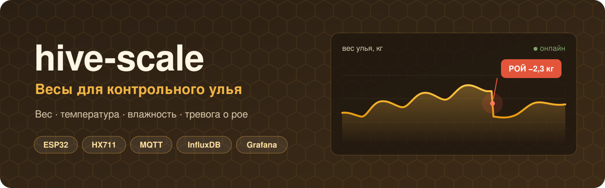
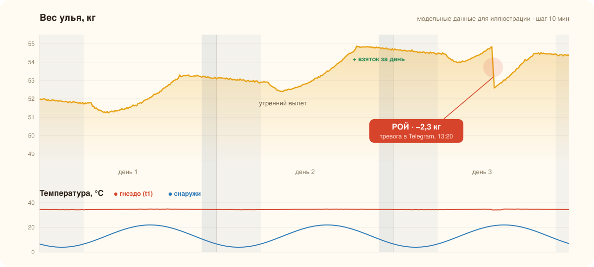
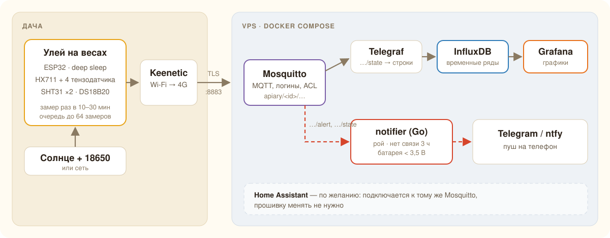
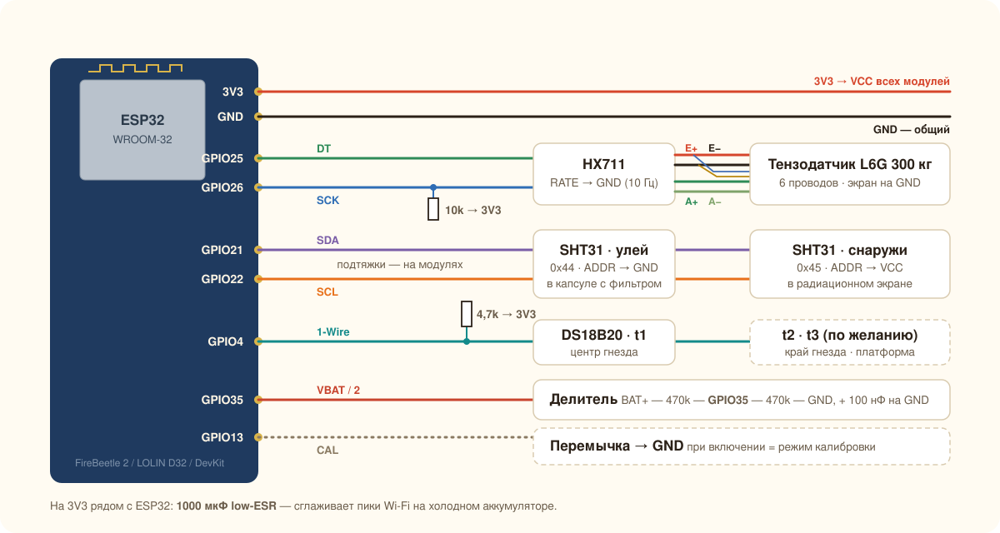
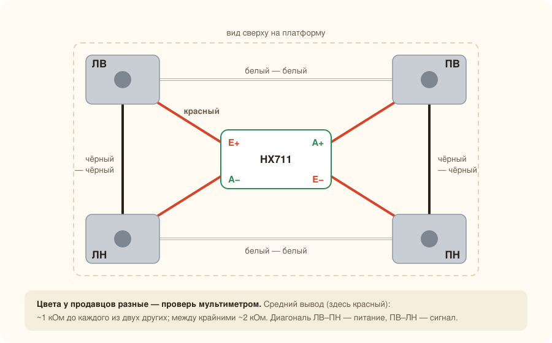
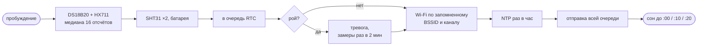

<p align="center">
  
</p>

<p align="center">
  <a href="https://github.com/Shchegolyaev/hive-scale/actions/workflows/ci.yml"></a>
  
  
  
  
  
</p>

Самодельные весы для контрольного улья. Под ульем стоит платформа на тензодатчиках, ESP32 раз в 10–30 минут просыпается, взвешивает улей, измеряет температуру и влажность в гнезде и снаружи и отправляет данные на сервер. На сервере их видно в Grafana. При резком падении веса (похоже на рой) приходит уведомление в Telegram.

<sub>🇬🇧 DIY beehive scale: ESP32 + HX711 + 4 load cells, SHT31/DS18B20, deep sleep on solar, MQTT → InfluxDB → Grafana, on-device swarm detection with Telegram/ntfy alerts.</sub>

## Что умеет

- ⚖️ **Вес улья до 200 кг**: один промышленный тензодатчик, медианный фильтр и поправка на температуру.
- 🌡️ **Микроклимат**: температура и влажность под потолочиной и снаружи, до трёх точек температуры в гнезде.
- 🐝 **Тревога о рое**: детектор работает на самом ESP32, уведомление приходит через секунды после замера, после тревоги замеры идут раз в 2 минуты.
- 🔋 **Автономность**: deep sleep, весы обесточены между замерами, на морозе и при низком заряде интервал увеличивается сам.
- 📶 **Работа с плохой связью**: до 64 замеров копятся в памяти и досылаются с исходным временем.
- 🔒 **Безопасность**: MQTT поверх TLS, у каждого улья свой логин, ACL не даёт писать в чужие топики.
- 📊 **Готовый сервер**: `docker compose up` поднимает Mosquitto, Telegraf, InfluxDB, Grafana и сервис уведомлений.

<p align="center">
  
</p>
<p align="center"><sub>Так выглядит рой на графике (модельные данные): каждый день виден утренний вылет пчёл и привес от взятка, на третий день вес резко падает на 2,3 кг.</sub></p>

## Содержание

1. [Архитектура](#архитектура)
2. [Детали](#детали)
3. [Платформа](#платформа)
4. [Схема подключения](#схема-подключения)
5. [Питание](#питание)
6. [Прошивка](#прошивка)
7. [Калибровка](#калибровка)
8. [Сервер](#сервер)
9. [Что смотреть в данных](#что-смотреть-в-данных)
10. [Структура репозитория](#структура-репозитория)

---

## Архитектура

<p align="center"></p>

**MQTT, InfluxDB и Grafana стоят на VPS, а не на Home Assistant.** На даче нет постоянно включённого сервера, а на VPS всё и так работает в Docker. Устройство просто публикует JSON в MQTT. Если позже на даче появится мини-ПК, Home Assistant подключится к тому же брокеру без перепрошивки ([пример](#home-assistant)).

**Рой определяет сам ESP32.** Он видит каждый замер и после подозрения сам переходит на частые замеры. Сервер только пересылает тревогу в мессенджер и дополнительно следит, что улей не пропал со связи.

**Мобильный интернет может пропадать надолго.** Поэтому замеры копятся в RTC-памяти: 64 штуки, это около 10 часов при 10-минутном интервале. Брокер лучше держать на VPS, который доступен из российской мобильной сети при ограничениях.

---

## Детали

| Узел | Что | Комментарий |
|---|---|---|
| Контроллер | **DFRobot FireBeetle 2 ESP32-E** или LOLIN D32 | Малый ток сна и встроенная зарядка. Обычный DevKit с CH340/CP2102 и AMS1117 во сне потребляет 5–10 мА и годится только при питании от сети. Если репитер далеко, бери ESP32-WROOM-32**U** с внешней антенной |
| АЦП весов | HX711, лучше «SparkFun-подобный» (красный или фиолетовый) | Дешёвые зелёные тоже работают. Если показания скачут, проверь, что E− соединён с GND (известный дефект части плат). Вывод RATE подключи к GND: 10 Гц, меньше шума |
| Тензодатчик | **одноточечный L6G 200 кг**, класс C3, IP65 | Запас на улей 100 кг, снег и нагрузку рукой при осмотре. Рассчитан на платформу до 600×600 |
| Температура и влажность | 2 × SHT31-D | Датчик в улье ставь в металлический корпус с фильтром, иначе пчёлы его запрополисуют. Наружный — в радиационный экран |
| Температура гнезда | 1–3 × DS18B20 в стальной гильзе | t1 — центр гнезда, t2 — край, t3 — платформа (для термокомпенсации) |
| Питание от солнца | 2 × 18650 параллельно; панель 6 В на 6–10 Вт; модуль заряда **CN3791** с NTC 10 кОм | NTC обязателен: Li-ion **нельзя заряжать ниже 0 °C** |
| Питание от сети | БП 12 В + понижающий модуль MP1584 в корпусе | Если розетка в 20–30 м, это самый надёжный вариант на зиму |
| Мелочь | резисторы 10к, 4,7к, 2 × 470к; конденсаторы 100 нФ × 2, 1000 мкФ 6,3 В low-ESR | 1000 мкФ на 3V3 сглаживают провалы при включении Wi-Fi на холодном аккумуляторе |
| Корпус | IP65 ~150×100×70, гермовводы PG7/PG9, дышащий клапан, силикагель | Без клапана внутри будет конденсат |
| Провода | экранированный 4-жильный для датчика веса, витая пара для I2C, гофра | Гофра защищает от мышей зимой |
| Каркас и платформа | брус 100×100 на ножки, доска 50×100 и 50×200, ламинированная фанера 27 мм, крепёж | Полный список с раскроем — в [инструкции по сборке](docs/BUILD.md) |

---

## Платформа

<p align="center"></p>

Всё из дерева, и всего **9 деревянных деталей**: четыре ножки из бруса, два лежня, поперечина, траверса и настил из толстой фанеры. Датчик L6G стоит в центре, между поперечиной и траверсой. Сварка не нужна.

- **Не шатается.** Датчик прикручен болтами и к раме, и к настилу, а в торцах ножек под углами настила стоят стоп-болты с зазором 3 мм.
- **Удобная высота.** Настил около 36 см от земли — в диапазоне 30–40 см, который обычно советуют для улья. Верхний корпус на уровне пояса.
- **С наклоном к летку на 1–2 см,** чтобы конденсат стекал наружу.

**[→ Чертежи, список материалов с раскроем и пошаговая сборка](docs/BUILD.md)**

<p align="center">
  <a href="docs/BUILD.md"></a>
  <a href="docs/BUILD.md"></a>
</p>

---

## Схема подключения

<p align="center"></p>

| ESP32 | Куда |
|---|---|
| 3V3 | VCC модулей HX711, обоих SHT31, DS18B20 |
| GND | общий |
| GPIO25 | HX711 DT |
| GPIO26 | HX711 SCK **+ 10 кОм на 3V3**: держит HX711 выключенным, пока ESP32 спит |
| GPIO21 / GPIO22 | SDA / SCL обоих SHT31 |
| GPIO4 | DS18B20 DQ + 4,7 кОм на 3V3 |
| GPIO35 | середина делителя BAT+ — 470к — GPIO35 — 470к — GND, плюс 100 нФ на GND |
| GPIO13 | перемычка на GND = режим калибровки |

Пины задаются в [`config.h`](firmware/include/config.h). На FireBeetle 2 делитель батареи уже распаян: посмотри по схеме платы, на какой GPIO он выведен, и поправь `PIN_VBAT`.

Провода L6G: красный — E+, чёрный — E−, зелёный — A+, белый — A−, экран — на GND со стороны HX711. Цвета сверь с паспортом датчика.

<details>
<summary><b>Вариант с четырьмя полумостами от напольных весов</b></summary>

Так дешевле, но механика сложнее: нужны держатели под каждый угол, а верхняя рама опирается только на кнопки датчиков.

<p align="center"></p>

Соседние датчики соединяются по кольцу: белый с белым, чёрный с чёрным. Средние выводы одной диагонали дают питание моста (E+/E−), другой — сигнал (A+/A−). Есть готовые платы объединения на 4 датчика, они делают то же самое.

**Проверка:** один и тот же груз на каждом углу должен давать примерно одинаковый прирост. Если какой-то угол даёт около нуля или минус, у этого датчика перепутаны концы. Если весь вес отрицательный, поменяй местами A+ и A−.
</details>

---

## Питание

**Потребление (оценка).** Одно пробуждение с TLS длится 5–8 с при ~120 мА, это около 0,2 мА·ч. Летом выходит 20–25 мА·ч в сутки, зимой около 10 мА·ч. Главное — мост тензодатчиков (~1 кОм) обесточен во сне, для этого линия SCK удерживается в «1».

| Вариант | Плюсы | На что обратить внимание |
|---|---|---|
| **Сеть** | никаких проблем с морозом | кабель в гофре, БП в корпусе |
| **2 × 18650 + солнце** | автономно, ~6000 мА·ч хватит на зиму даже без солнца | на морозе ёмкость падает вдвое, поэтому аккумуляторы держи в утеплённом боксе, а заряд с NTC должен блокироваться ниже 0 °C |
| **LiFePO4 + солнце** | лучше переносит холод, безопаснее | нужен подходящий контроллер заряда, ниже 0 °C тоже не заряжать |

Прошивка сама увеличивает интервал до часа при `vbat < 3,45 В`, а сервис уведомлений предупреждает при < 3,5 В.

---

## Прошивка

```bash
git clone https://github.com/Shchegolyaev/hive-scale.git
cd hive-scale/firmware
cp include/secrets.example.h include/secrets.h   # Wi-Fi, адрес брокера, пароль, CA-сертификат
pio run -t upload && pio device monitor
```

Все настройки лежат в [`config.h`](firmware/include/config.h): пины, интервалы, пороги роя, термокомпенсация. Пароли хранятся в `secrets.h`, этот файл в `.gitignore`. Для FireBeetle поменяй `board` в [`platformio.ini`](firmware/platformio.ini).

### Цикл работы



- Если Wi-Fi нет три раза подряд, ESP32 будит себя раз в 30 минут, замеры копятся.
- Через 45 с бодрствования ESP32 уходит в сон в любом случае, даже если что-то зависло.
- Пока время не синхронизировано по NTP, метки идут «от 1970 года». После синхронизации прошивка пересчитывает их, данные не теряются.

| Время суток и условия | Интервал |
|---|---|
| день (6–22) | 10 мин |
| ночь | 30 мин |
| снаружи ниже +5 °C | 30 мин |
| батарея < 3,45 В | 60 мин |
| после тревоги | 2 мин × 8 |

### Сообщение `apiary/hive1/state`

```json
{"ts":1782650400,"raw":-184523,"w":54.125,"t_in":34.21,"h_in":61.0,
 "t_out":18.40,"h_out":72.5,"t1":34.75,"vbat":3.912,"rssi":-71,"boot":1203,"queue":0}
```

Поле `raw` отправляется всегда: если позже уточнишь калибровку, историю можно пересчитать на сервере.

### Детектор роя

| Тревога | Условие |
|---|---|
| `swarm` | вес упал на **1,2–6 кг** от максимума за последние ~25 мин; май–август, 9:00–19:00, снаружи ≥ 14 °C; не чаще раза в час |
| `big_drop` | падение больше 6 кг в любое время: осмотр, снятие магазина или кто-то у улья |

Рой из улья на 12 рамок уносит 1,5–3 кг за 10–15 минут. Порог 1,2 кг его ловит, а утренний вылет пчёл идёт медленнее и тревогу не вызывает. В первый сезон посмотри на графики и при ложных срабатываниях подними порог до 1,5 кг.

---

## Калибровка

Поставь перемычку GPIO13–GND, включи питание и открой монитор порта на 115200.

| Команда | Что делает |
|---|---|
| `s` | ищет датчики: оба SHT31 (0x44, 0x45) и DS18B20 с их адресами |
| `t` | тарирует пустую платформу (ноль по 64 отсчётам) |
| `c 20.5` | калибрует по известному грузу, вес вводится в кг |
| `r` | делает 5 контрольных замеров |
| `k 0.012` | задаёт коэффициент термокомпенсации, кг/°C |
| `p` | показывает текущую калибровку |
| `x` | выходит и перезагружает в рабочий режим |

1. `s`: определи, какой DS18B20 какой. Грей их пальцами по очереди.
2. Собери платформу **без улья**, с настилом, но без ремней. Выполни `t`.
3. Положи груз 15–30 кг (блины от штанги или канистры, взвешенные на нормальных весах) и выполни `c <вес>`.
4. Проверь вторым грузом другой массы через `r`. Ошибка должна быть меньше 0,5 %.
5. **Тест углов**: поставь один и тот же груз по очереди на каждый угол. Разброс больше 1 % значит, что настил где-то касается стоп-болта или упора, либо он больше, чем допускает датчик.
6. Сними перемычку и выполни `x`.

<details>
<summary><b>Термокомпенсация</b> (по желанию, через пару недель работы)</summary>

Полумосты «гуляют» с температурой, суточная пила в 100–300 г для них нормальна. Чтобы её убрать, оставь на платформе постоянный груз (не улей!) на 2–3 дня. Потом в Grafana построй `w` против `t_out` (или против `t3` на платформе, тогда в `config.h` поставь `TC_SOURCE 2`). Наклон прямой — это коэффициент в кг/°C, введи его командой `k`. Опорная температура запишется текущая.
</details>

---

## Сервер

```bash
cd server
cp .env.example .env && nano .env   # пароли, токен InfluxDB (openssl rand -hex 32), Telegram и/или ntfy
```

<details>
<summary><b>Сертификат и пользователи MQTT</b></summary>

```bash
# сертификат для MQTT (домен mqtt.example.com указывает на IP VPS)
certbot certonly --standalone -d mqtt.example.com \
  --deploy-hook 'cp -L /etc/letsencrypt/live/mqtt.example.com/{fullchain,privkey}.pem /opt/hive/server/mosquitto/certs/ \
                 && chown 1883:1883 /opt/hive/server/mosquitto/certs/* && docker restart server-mosquitto-1'

# пользователи (логин улья = его id: ACL разрешает писать только в apiary/<логин>/#)
docker run --rm -v "$PWD/mosquitto:/m" eclipse-mosquitto:2 mosquitto_passwd -c -b /m/passwd hive1    'пароль-улья'
docker run --rm -v "$PWD/mosquitto:/m" eclipse-mosquitto:2 mosquitto_passwd    -b /m/passwd telegraf 'MQTT_TELEGRAF_PASS'
docker run --rm -v "$PWD/mosquitto:/m" eclipse-mosquitto:2 mosquitto_passwd    -b /m/passwd notifier 'MQTT_NOTIFIER_PASS'
```

Путь `/opt/hive/server` и имя контейнера в deploy-hook поправь под себя. В первый раз скопируй сертификаты той же командой `cp`, не дожидаясь продления.
</details>

```bash
docker compose up -d --build
```

Проверить уведомления можно так:

```bash
mosquitto_pub -h mqtt.example.com -p 8883 --capath /etc/ssl/certs -u hive1 -P 'пароль-улья' \
  -t apiary/hive1/alert -m '{"type":"swarm","drop":1.8,"w":52.3,"ts":'$(date +%s)'}'
```

**Grafana** слушает только `127.0.0.1:3000`. Открывай её через `ssh -L 3000:localhost:3000 vps` или поставь перед ней nginx/caddy с TLS.

**Уведомления.** Для Telegram создай бота у [@BotFather](https://t.me/BotFather) и напиши ему что-нибудь, а `chat_id` возьми из `https://api.telegram.org/bot<TOKEN>/getUpdates`. Вместо Telegram или вместе с ним можно использовать [ntfy](https://ntfy.sh): пуш приходит на телефон, рой — с приоритетом urgent. Сервис [`notifier`](server/notifier/main.go) сообщает о рое и резком сбросе веса, о пропаже связи на 3 часа и её возвращении, а также о батарее ниже 3,5 В (не чаще раза в сутки).

<details>
<summary><b>Запросы для Grafana (Flux)</b></summary>

Вес:
```flux
from(bucket: "hives")
  |> range(start: v.timeRangeStart, stop: v.timeRangeStop)
  |> filter(fn: (r) => r._measurement == "hive" and r.hive == "hive1" and r._field == "w")
  |> aggregateWindow(every: v.windowPeriod, fn: mean, createEmpty: false)
```

Суточный привес по вечернему весу, когда пчёлы дома (удобно смотреть столбцами):
```flux
import "date"
import "timezone"

from(bucket: "hives")
  |> range(start: -60d)
  |> filter(fn: (r) => r._measurement == "hive" and r.hive == "hive1" and r._field == "w")
  |> filter(fn: (r) => date.hour(t: r._time, location: timezone.location(name: "Europe/Moscow")) >= 22)
  |> aggregateWindow(every: 1d, fn: last, createEmpty: false, location: timezone.location(name: "Europe/Moscow"))
  |> difference()
```

Для температур подойдёт тот же запрос с `r._field =~ /^(t_in|t_out|t1|t2)$/`. Служебные поля: `vbat`, `rssi`, `queue`. По `queue > 0` видно, когда пропадала связь.
</details>

<details id="home-assistant">
<summary><b>Home Assistant</b></summary>

HA подключается к тому же Mosquitto под отдельным пользователем с правом чтения `apiary/#`:

```yaml
mqtt:
  sensor:
    - name: "Улей 1 вес"
      state_topic: "apiary/hive1/state"
      value_template: "{{ value_json.w }}"
      unit_of_measurement: "kg"
      device_class: weight
      state_class: measurement
    - name: "Улей 1 t гнезда"
      state_topic: "apiary/hive1/state"
      value_template: "{{ value_json.t1 }}"
      unit_of_measurement: "°C"
      device_class: temperature
```

HA записывает время получения сообщения, а не `ts` из него. Поэтому после пропадания связи все накопленные замеры лягут в одну минуту. У InfluxDB с Telegraf этой проблемы нет.
</details>

---

## Что смотреть в данных

| На графике | Что это значит |
|---|---|
| утренний провал 0,3–1 кг, вечером вес возвращается | лётные пчёлы улетели и вернулись; глубина провала показывает силу лёта |
| привес «вечер к вечеру» | сила взятка; несколько дней в минусе в сезон — взятка нет |
| ступенька вниз на 1,5–3 кг днём | рой |
| зимой ровное снижение 30–60 г в сутки | нормальный расход корма |
| зимой резкие ступеньки | снег лёг на крышку или сошёл с неё |
| `t1` и `t2` | где находится клуб; рост до 34–35 °C в конце зимы — матка начала червить |
| `h_in` зимой долго выше 85–90 % | пора проверить вентиляцию |

---

## Структура репозитория

```
firmware/
  include/config.h            настройки: пины, интервалы, пороги роя
  include/secrets.example.h   шаблон паролей → secrets.h
  src/main.cpp                прошивка
  platformio.ini
server/
  docker-compose.yml          Mosquitto, Telegraf, InfluxDB, Grafana, notifier
  mosquitto/                  конфиг брокера и ACL
  telegraf/telegraf.conf      MQTT → InfluxDB
  grafana/provisioning/       источник данных InfluxDB
  notifier/                   уведомления в Telegram / ntfy (Go)
docs/
  BUILD.md                    сборка платформы: чертежи, материалы, шаги
  img/                        схемы, чертежи и картинки
  tools/model.py              модель платформы (размеры) → чертежи и 3D
  tools/build_drawings.py     генератор видов спереди и сверху
  tools/render3d.html         3D-вид (three.js)
  tools/gen_chart.py          генератор примера графика
```

## Идеи на будущее

- [ ] обновление прошивки по воздуху (OTA) через MQTT-команду
- [ ] несколько ульев на одном ESP32 (по HX711 на улей)
- [ ] готовый дашборд Grafana в provisioning
- [ ] микрофон в улье: по звуку можно заметить подготовку к роению и отсутствие матки

## Лицензия

[MIT](LICENSE)
