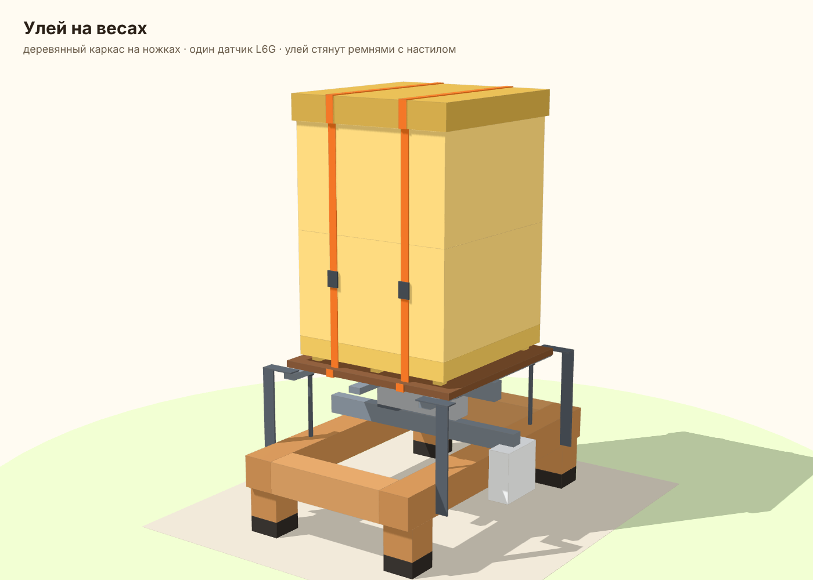
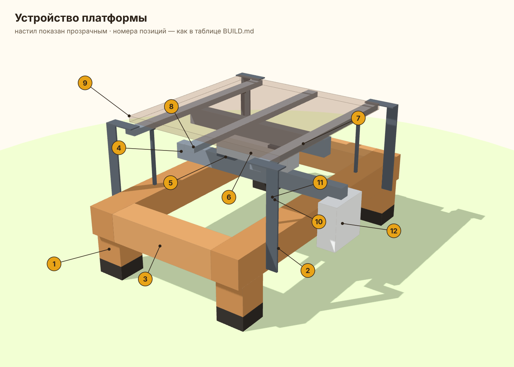
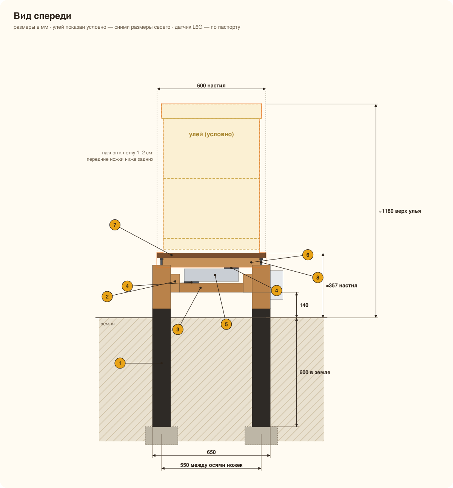
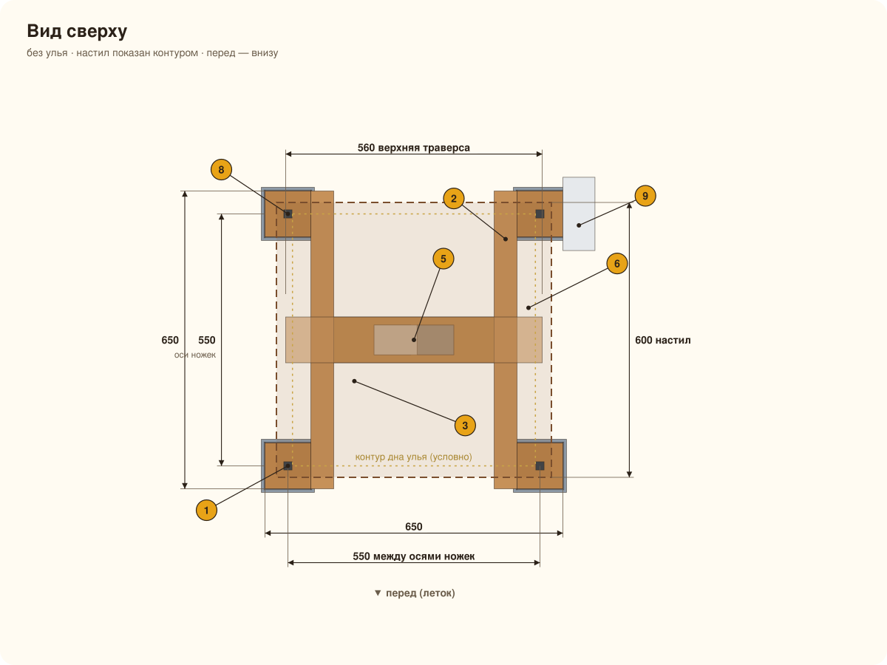

# Сборка платформы

Деревянный каркас на четырёх ножках, а между двумя стальными траверсами в центре — один платформенный тензодатчик. Улей стоит на настиле из ламинированной фанеры и стянут с ним ремнями. Всё собирается на болтах и саморезах, сварка не нужна.

**Почему так:**
- **Не шатается.** Датчик прикручен болтами к обеим траверсам, и настил ощущается как цельный стол. Если опереться на угол, он уходит максимум на 1,5–2 мм и встаёт на стоп-болт.
- **Не опрокидывается.** Ножки вкопаны, а Г-образные упоры не дают настилу подняться при сильном ветре.
- **Невысокий.** Настил примерно в 50 см от земли, верх улья с двумя корпусами — около 1,3 м.
- **Датчик под крышей.** Настил закрывает его от дождя, а сам датчик защищён по IP65.

---

## Чертежи

> [!IMPORTANT]
> Перед покупкой **измерь дно своего улья**: на чертежах улей условный, 530×550. Настил делай на 20–40 мм больше дна с каждой стороны, но не больше 600×600 — это предел платформы для L6G. Высоту датчика и расположение его отверстий возьми из паспорта: от них зависят проставки и длина болтов.

---

## Позиции

| № | Деталь | Материал | Размер, мм | Кол-во |
|---|---|---|---|---|
| 1 | Ножка | брус 100×100: лиственница или с автоклавной пропиткой | 750 (150 над землёй + 600 в земле) | 4 |
| 2 | Лежень | брус 100×100 | 1000 | 2 |
| 3 | Поперечина | брус 100×100 | 400 | 2 |
| 4 | Нижняя траверса | профтруба 60×40×3 | 700 | 1 |
| 5 | Проставка | стальная пластина 10 мм, по размеру опорной площадки датчика | ≈80×70 | 2 |
| 6 | Тензодатчик | одноточечный **L6G 200 кг, C3**, IP65 | по паспорту | 1 |
| 7 | Верхняя траверса | профтруба 60×40×3 | 560 | 1 |
| 8 | Ребро | профтруба 40×20×2 | 700 | 3 |
| 9 | Настил | ламинированная фанера 21 мм | 600×600 (по улью) | 1 |
| 10 | Стоп-болт | шуруп-шпилька М10×200 + 2 гайки и шайба | — | 4 |
| 11 | Г-упор | уголок 40×40×4: стойка 340 + полка 120 | — | 4 |
| 12 | Корпус электроники | IP65 ~150×100×70 | — | 1 |

**Сколько покупать:**
- брус 100×100 — около 6 м: один брус на 6 м или три по 3 м (двух по 3 м не хватит);
- профтруба 60×40×3 — 1,3 м;
- профтруба 40×20×2 — 2,1 м;
- уголок 40×40×4 — 2 м;
- фанера — кусок 600×600 (в строительных магазинах обычно раскраивают лист).

### Крепёж

| Что | Куда | Кол-во |
|---|---|---|
| Болт М10×180 + 2 шайбы + гайка | нижняя траверса → лежни, насквозь | 4 |
| Болт **М8 класса 8.8**, длина ≈80 (уточни по глубине резьбы датчика) + шайба | датчик → траверсы, через проставки | по числу отверстий датчика |
| Втулка из трубки Ø12–14, длина 54 мм | внутрь профтрубы на каждый сквозной болт, чтобы гайка не смяла профиль | на каждый болт через траверсы |
| Саморез по металлу с буром 4,8×38 | рёбра → верхняя траверса | 6 |
| Саморез по металлу с буром, потайной, 4,2×32 | настил → рёбра | 15 |
| Уголок крепёжный усиленный 90×90 + саморезы по дереву 6×40 | ножки → лежни | 8 уголков, ~40 саморезов |
| Глухарь 10×180 | лежень → торец поперечины | 4 |
| Глухарь 8×60 | стойки Г-упоров → лежни | 8 |
| Болт М8×25 + гайка | полка Г-упора → стойка | 4 |
| Ремень с храповиком 25 мм, 3–4 м | улей + настил | 2 |

Крепёж бери оцинкованный.

### Защита и расходники

- **Антисептик для дерева в контакте с грунтом**, трудновымываемый (например, Сенеж Ультра или Неомид 430 Eco) — для ножек, если брус без заводской пропитки.
- **Битумная мастика** — на часть ножек в земле и ещё 5 см над ней.
- **Щебень фракции 20–40** — 3–4 ведра на ямы.
- **Грунт-эмаль по металлу 3-в-1** — на все срезы и отверстия в стали.
- **Масло или декоративный антисептик** — на дерево над землёй. Торцы фанеры закрой герметиком или краской.

### Инструмент

- ручной бур Ø200–250 (или лопата);
- уровень на 1 м;
- рулетка, угольник;
- ножовка или торцовка;
- болгарка с отрезным кругом;
- дрель, свёрла по металлу 5, 6,5, 9 и 11 мм;
- ключи на 13 и 17;
- динамометрический ключ — желательно: момент затяжки болтов датчика по паспорту, для L6G это 25 Н·м;
- щуп или пара шайб толщиной 1,5–2 мм, чтобы выставить зазор стоп-болтов.

---

## Ножки в земле

Одной покраски мало: обычная сосна в земле без защиты сгниёт за 3–5 лет. Чтобы ножки простояли 10 лет и больше:

1. **Материал.** Лучше всего лиственница или брус с автоклавной пропиткой (зеленоватый). Обычную сосну пропитай антисептиком для контакта с грунтом в два слоя с просушкой между ними.
2. **Мастика.** Нижние 650 мм каждой ножки (600 в земле + 50 над землёй) покрой битумной мастикой в 2 слоя. Торец обмакни в мастику целиком.
3. **Яма.** На дно насыпь 10 см щебня. Засыпай тоже щебнем, слоями по 10–15 см, трамбуя каждый. **Не бетонируй**: в бетонном «стакане» стоит вода и дерево гниёт быстрее.
4. **Чем не пользоваться.** Отработка и креозот не годятся: пчёлы рядом не любят запаха, а в землю это лучше не лить.

> [!TIP]
> **Вариант совсем без дерева в земле.** Вместо вкопанных ножек забей четыре **забивных анкера для столба 100×100** (пика длиной 600–750 мм) или вкрути **винтовые сваи Ø57** с оголовком. Ножки вставь в анкеры, и дерево не касается земли вообще. Высота над землёй и все размеры выше остаются те же. В каменистом грунте анкеры забиваются тяжело.

---

## Порядок сборки

1. **Место.** Выбери ровное место с защитой от ветра (забор, кусты), леток на юг или юго-восток. Размечаешь прямоугольник 500 × 860 по осям ножек; проверь, что диагонали равны.
2. **Ножки.** Пропитай их и нанеси мастику, дай высохнуть.
3. **Ямы.** Выкопай 4 ямы глубиной 700 мм (600 + 100 на щебень). Поставь ножки, засыпь щебнем с трамбовкой. Верх ножек выведи по уровню в одну плоскость, на 150 мм над землёй. Проще оставить их чуть выше, а потом срезать по шнурке или уровню.
4. **Рама.** Положи лежни на ножки и закрепи усиленными уголками. Между лежнями на концах поставь поперечины на глухари 10×180, через лежень в торец. Проверь диагонали и уровень.
5. **Нижняя траверса.** Положи её поперёк лежней точно по центру и прикрути болтами М10×180 насквозь, со втулками внутри профиля.
6. **Датчик.** Поставь проставку под **неподвижный** конец датчика (с этой стороны обычно выходит кабель). **Стрелка на датчике должна смотреть вниз**, по направлению нагрузки. Затяни болты М8 с моментом из паспорта.
7. **Верхняя траверса.** Поставь проставку на **грузовой** конец и прикрути траверсу сверху. Проверь, что датчик касается траверс только через проставки и везде остаётся зазор не меньше 5 мм.
8. **Рёбра и настил.** Положи три ребра поперёк верхней траверсы через 250 мм и прикрути саморезами. Сверху положи настил и прикрути потайными саморезами к рёбрам.
9. **Стоп-болты.** Вкрути шуруп-шпильки в лежни под крайними рёбрами, в 250 мм вперёд и назад от центра. Верхнюю гайку выставь так, чтобы между ней и ребром был **зазор 1,5–2 мм**, и законтри нижней гайкой. Под весом полного улья ребро опустится меньше чем на миллиметр, поэтому при обычной работе стоп-болт ничего не касается.
10. **Г-упоры.** Прикрути стойки к наружным граням лежней напротив концов крайних рёбер, по две на сторону. Сверху привинти полки так, чтобы они нависали над концами рёбер с зазором 3–5 мм. Это защита от опрокидывания: в обычном режиме упоры ничего не касаются.
11. **Покраска.** Закрась все срезы и отверстия в стали, торцы фанеры — герметиком.
12. **Электроника.** Корпус крепится на лежень, то есть на неподвижную часть. Кабель датчика веди в гофре и сделай петлю-капельник перед гермовводом.
13. **Проверка.** Нажми на угол настила: он должен уйти на 1–2 мм и встать на стоп-болт. Толкни настил вбок: рама не должна ходить. Потом сделай калибровку по [README](../README.md#калибровка).
14. **Улей.** Поставь улей ножками дна по центру настила. Пропусти два ремня под настилом между рёбрами, затем через крышу, и затяни храповиками.

> [!WARNING]
> Ремни и любые другие крепления должны охватывать **только улей и настил**. Если ремень, провод или ветка касается лежней или ножек, часть веса уходит мимо датчика.

---

## Подключение L6G

У датчика 4 провода и экран. Обычная маркировка у Zemic такая, но **сверь с паспортом своего датчика**:

| Провод | HX711 |
|---|---|
| красный | E+ |
| чёрный | E− |
| зелёный | A+ |
| белый | A− |
| экран | GND, только со стороны HX711 |

Если вес получается отрицательным, поменяй местами A+ и A−.

---

## Если умеешь варить

Ту же конструкцию можно сварить из профтрубы: ножки 60×60 с пятками, рама из 60×40. Все размеры по осям остаются те же. Дерево только тогда не нужно совсем, а сварной каркас ещё жёстче.

Чертежи генерируются из [`tools/model.py`](tools/model.py): поменяй размеры там и запусти `python3 docs/tools/build_drawings.py`. 3D-вид — [`tools/render3d.html`](tools/render3d.html).
