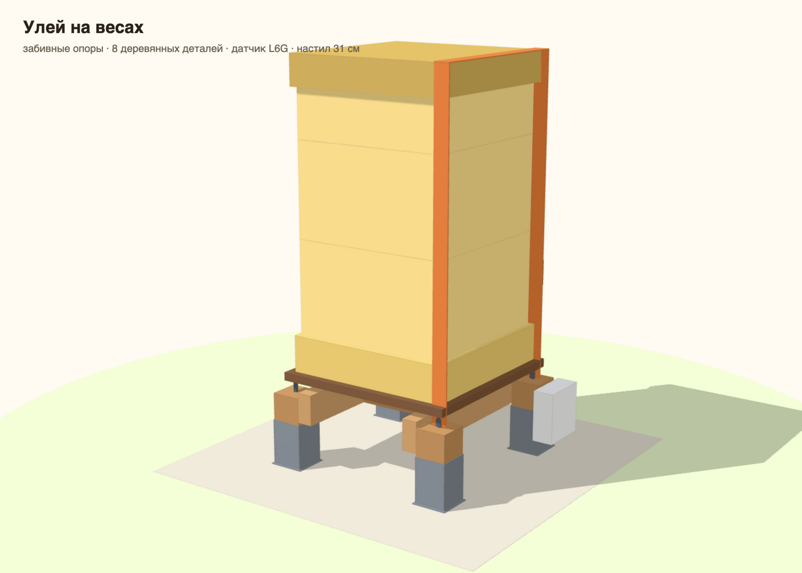
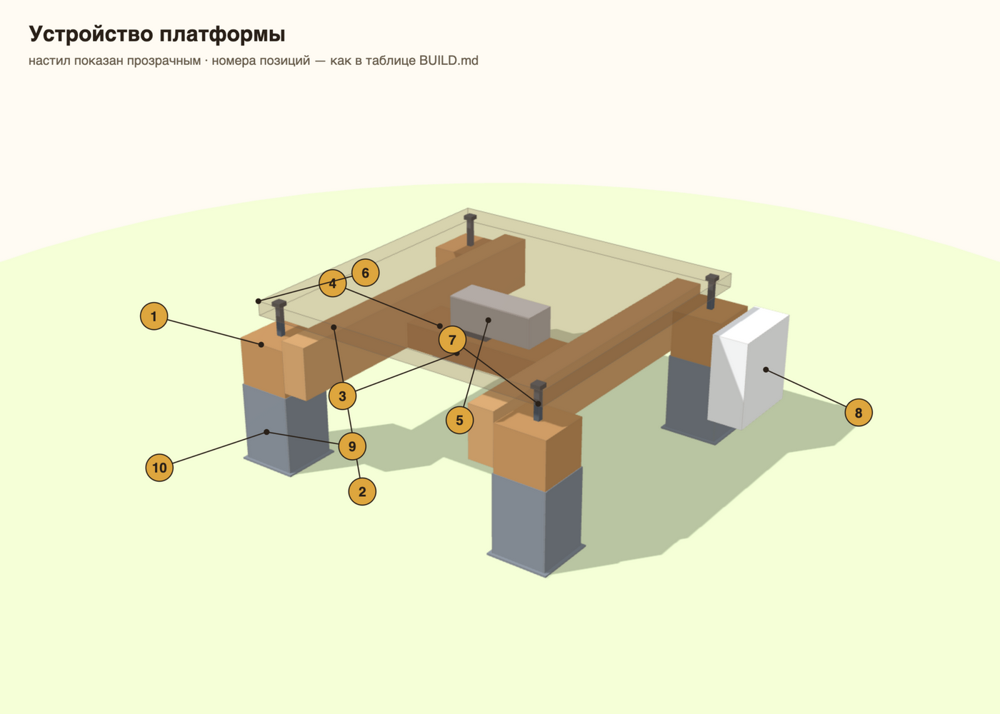
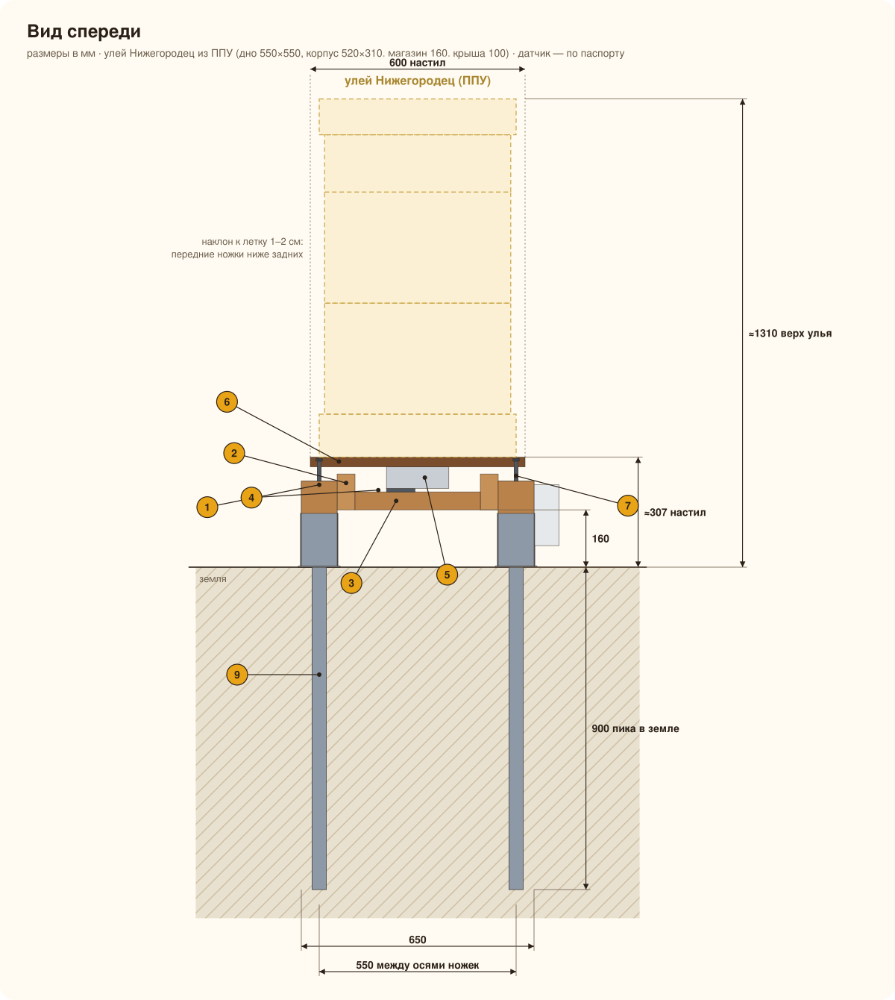
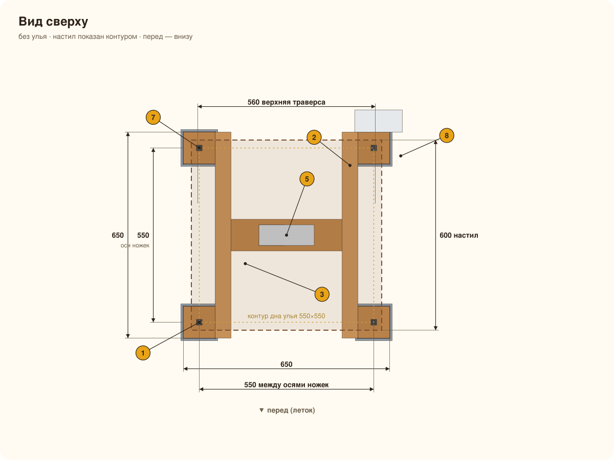

# Сборка платформы

Простая деревянная платформа на четырёх забивных опорах. Каркас собирается из **восьми деревянных деталей**: четыре ножки из бруса, два лежня и поперечина из доски 50×100, плюс фанерный настил. **Настил лежит прямо на датчике** — как в промышленных платформенных весах, без промежуточной траверсы. Металл только там, где без него никак: опоры, тензодатчик, стальная проставка и крепёж. Сварка не нужна, ямы копать не нужно.

**Как устроено:**
- **Опоры.** Четыре стальные забивные опоры вбиты в землю кувалдой. В их стаканах стоят короткие ножки из бруса 100×100: дерево не касается земли и не гниёт.
- **Рама.** К ножкам прикручены два лежня, между лежнями — средняя поперечина.
- **Датчик.** Одноточечный **L6G** лежит на средней поперечине, и **настил из толстой фанеры прикручен прямо к его грузовой площадке** — как в промышленных платформенных весах. Вес идёт так: настил → датчик → поперечина → лежни → ножки → опоры. Больше никаких связей между настилом и рамой нет.
- **Стоп-болты** в торцах ножек, под углами настила, с зазором 3 мм. Если опереться на угол или резко поставить корпус, нагрузку примут они, а не датчик.
- **Высота настила около 31 см.** Для улья это золотая середина: под дном проходит воздух, леток выше травы, от земли не тянет сыростью. Верхний корпус — на уровне пояса, верх улья — около 1,3 м.

<b>Почему так просто — и чего здесь нет специально</b>

- **Нет рёбер под настилом.** Фанера 27 мм опирается на грузовую площадку датчика в центре и держит улей на 25 см по сторонам от неё. Прогиб под дном улья — меньше миллиметра.
- **Нет упоров от опрокидывания.** Датчик прикручен болтами и к раме, и к настилу, так что настилу некуда «слететь». В бурю (ветер 25 м/с) настил наклоняется до стоп-болта, а на датчик приходится обратная нагрузка около 50 кг. Это меньше веса самого улья, и запас прочности L6G перекрывает её с избытком. Опоры забиты на 90 см. **Но улей из ППУ лёгкий и высокий** (стек до 1,4 м, пустой ~20 кг): незакреплённый, его может опрокинуть ветер — ремни здесь обязательная часть конструкции, а не перестраховка.
- **Нет крайних поперечин.** Опоры держат ножки на месте, а «Н» из двух лежней и поперечины не перекосится.
- **Поперечина — доска 50×100 плашмя, без глухарей.** Она держится только на полках уголков: вес несёт смятие полок, шесть саморезов 6×40 фиксируют доску. Расчёт и запасы — выше; самое глубокое сверление сборки (Ø6 на 120 мм) исчезло вместе с глухарями.
- **Дерево не в земле.** Поэтому подходит обычная сухая сосна: ни лиственница, ни автоклавная пропитка, ни мастика не нужны.

---

## Этапы

1. **Каркас** (этот документ). Покупаешь опоры, дерево, крепёж, **датчик L6G** и две стальные проставки. Датчик нужен уже на этом этапе: он часть конструкции, по нему размечаются отверстия. Кабель датчика пока просто сматываешь и прячешь в пакет.
2. **Электроника** — когда каркас готов. ESP32, HX711, датчики температуры, питание: список в [README](../README.md#детали).

> [!NOTE]
> **Когда делать.** Опоры забиваются, пока земля не промёрзла. Пропитку и масло наносят при температуре выше +5…+10 °C, так что дерево удобнее обработать зимой под крышей, а собрать всё весной, до приезда пчёл. Запах к тому времени выветрится.

---

## Чертежи

> [!TIP]
> **Интерактивная 3D-сборка:** [`tools/assembly.html`](tools/assembly.html) — все 20 шагов с крепежом, анимацией вкручивания, отверстиями под сверление и крупными планами узлов. Скачай репозиторий и открой файл в браузере (нужен интернет для загрузки three.js).

> [!IMPORTANT]
> На чертежах улей **Нижегородец из ППУ**: дно 550×550×120, корпуса и магазин 520×520, крыша 550×550. Настил 600×600 даёт запас **25 мм на сторону** (норма 20–40 мм), предел платформы для L6G — 600×600. Под другой улей настил делай на 20–40 мм больше его дна. Высоту датчика и расположение его отверстий возьми из паспорта.

---

## Позиции

| № | Деталь | Материал | Размер, мм | Кол-во |
|---|---|---|---|---|
| 1 | Ножка | брус 100×100, сосна, сухая | задние: срез верха на **260 мм над землёй**, передние — на **250** (наклон 10 мм к летку); заготовки все 300 мм, метки «П»/«З» маркером | 4 (2+2) |
| 2 | Лежень | доска 50×100 на ребро | 650 | 2 |
| 3 | Средняя поперечина | доска 50×100 **плашмя**, враспор между лежнями | 350 (заготовка 400, подрезается на месте) | 1 |
| 4 | Проставка | **сталь 10 мм**, по размеру опорной площадки датчика | ≈80×65 | 1 |
| 5 | Тензодатчик | одноточечный **L6G 300 кг, C3**, IP65 | по паспорту | 1 |
| 6 | Настил | ламинированная фанера, **гладкая**, **27 мм** (подойдёт 24–30) | 600×600 (по улью) | 1 |
| 7 | Стоп-шпилька | шуруп-шпилька М10×100 + 2 гайки и шайба, в торец ножки — упор настила | — | 4 |
| 8 | Корпус электроники | IP65 — на наружной грани правого лежня, под настилом | — | 1 |
| 9 | Забивная опора | под брус 100×100, оцинкованная, стакан 150 мм, общая длина ~1050 мм | — | 4 |

### Что купить

| Материал | Сколько | Распил |
|---|---|---|
| Забивная опора под брус 100×100, общая длина ~1050 мм (пика 900 + стакан 150) | 4 шт. | — |
| Брус 100×100, сосна, сухая | 4 куска по 300 | можно попросить обрезки |
| Доска 50×100×3000, сосна, сухая, строганая | 1 шт. | 650 + 650 + 400, остаток ~1,2 м — на ступеньку и запас |
| Ламинированная фанера, гладкая (F/F), 27 мм | 600×600 | попроси раскроить в магазине |
| Полоса стальная, толщина 10 мм | 1 кусок ≈80×65 | нижняя проставка под датчик; отрежь в любой металлобазе |
| Тензодатчик Zemic L6G-C3-300kg | 1 | — |

**Сообщение на лесопилку:**

> Здравствуйте! Хочу заказать с распилом в размер:
> 1. Брус 100×100, сосна, сухая — 4 шт. по 300 мм (все одинаковые, подрезка по месту — моя).
> 2. Доска 50×100×3000, сосна, сухая, строганая — 1 шт., распилить на 650, 650, 400 мм, остаток тоже заберу.
>
> Брус без крупных сучков и трещин. Если есть, ещё нужен кусок ламинированной фанеры, гладкой, 27–30 мм, размером 600×600 мм.
>
> Подскажите, пожалуйста, цену и когда можно забрать. Спасибо!

### Крепёж

| Что | Куда | Кол-во |
|---|---|---|
| Саморез по дереву 5×50, оцинкованный | ножки → стаканы опор, по 4 на ножку (отверстия Ø5 уже в стакане) | 16 |
| Болт М10×160 кл. 8.8 + гайка + 2 увеличенные шайбы | лежни → ножки, насквозь, по 2 на ножку · сверло Ø11, ключ 17 | 8 компл. |
| Уголок крепёжный усиленный 70×70 | полки под поперечину, на внутренние грани лежней | 2 |
| Саморез по дереву 6×40 | уголки: 3 в лежень + 3 в поперечину на каждый · пилот Ø4 | 12 |
| Болт М8 кл. 8.8, полная резьба, 85 мм | датчик → поперечина, снизу, через проставку и пластину · Ø9 насквозь, 25 Н·м | 4 |
| Пластина 60×60×4 с отверстием Ø9 | под головки нижних болтов М8 (только снизу) | 1 |
| Винт М8 с потайной головкой, 45 мм | настил → датчик, сверху · Ø9 насквозь + зенковка, 25 Н·м | 4 |
| Шуруп-шпилька М10×100 + гайка М10 × 2 + шайба | стоп-шпильки в торцы ножек — упоры настила, зазор 3 мм · пилот Ø8 | 4 компл. |
| Штырь М6×50 + гайка-барашек + 2 шайбы | крепления ремня сквозь настил: передний — блок стяжки, задний — крюк · Ø6 насквозь | 2 компл. |
| Ремень самозатягивающийся крюк-болт, лента 50 мм, от 2,5 м | блок стяжки — на переднем штыре настила, крюк — на заднем; полотно через крышу по оси датчика | 1 |
| *Запасной вариант вместо крюк-болта:* ремни с храповиком 25 мм, 3–4 м | петли вокруг улья и настила, параллельно оси датчика | *2* |

Весь крепёж бери оцинкованный.

> [!NOTE]
> **Длины болтов М8.** Нижний: поперечина 50 + проставка 10 + пластина 4 = 64 мм, плюс 15–20 мм в резьбу датчика (глубина у L6G — 32 мм) → **М8×85**. Верхний: фанера 27 + 15–18 мм в датчик → **винт М8×45**. Сверься с паспортом своего датчика.

### Защита и расходники

- **Антисептик для наружных работ** — на всё дерево, а торцы ножек, которые стоят в стаканах, — особенно щедро.
- **Масло для террас, лазурь или фасадная краска на водной основе** — финишный слой над антисептиком. Обрабатывай заранее, чтобы к приезду пчёл запах выветрился.
- **Герметик или краска** — на торцы фанеры, отверстия в ней и на торцы ножек вокруг стоп-шпилек.
- **Графитовая смазка** — резьба стоп-шпилек и штырей ремня: не закиснет и не соберёт песок (в отличие от литола).
- **Лист резины 2–3 мм, сплошной (рифлёный), ≈550×550** — опционально, под дно улья: противоскольжение и защита фанеры от прополиса. Вес постоянный (~1,5 кг), уходит в тару. **Нельзя пористые коврики** (войлок, ковролин, пена): набирают воду — показания «дышат» на 100–300 г.

### Инструмент

- кувалда 3–5 кг и обрезок бруса 100×100 — вставлять в стакан и бить по нему, чтобы не помять стакан (или специальная насадка для забивания);
- уровень на 1 м;
- рулетка, угольник;
- ножовка или торцовка;
- дрель-шуруповёрт, свёрла по дереву 4, 6, 8, 9 и 11 мм, зенковка под потай (для винтов настила);
- ключи на 13 и 17;
- динамометрический ключ — желательно: момент для болтов датчика по паспорту, у L6G это 25 Н·м;
- щуп или шайбы толщиной 3 мм, чтобы выставить зазор стоп-болтов.

---

## Обработка дерева

**Сначала всё распили и просверли, потом обрабатывай**: каждый срез и отверстие открывают незащищённое дерево.

1. **Антисептик для наружных работ**, 1–2 слоя. Торцы и отверстия под болты — отдельно и щедро, в отверстия можно залить пропитку шприцем.
2. **Финишное покрытие**: масло для террас или лазурь на водной основе (обновлять раз в 1–2 года) или фасадная краска на водной основе (держится 3–5 лет).
3. **Фанера**: плоскости защищены плёнкой, их не трогай. Торцы и все отверстия закрой акриловым герметиком или 2–3 слоями краски.
4. **Для пчёл**: только средства на водной основе. **Нельзя** отработку, креозот, составы на растворителях. Дай всему выветриться 2–4 недели.

---

## Дерево, снег и весы

- **Сезонные движения дерева.** За сезон рама может уйти по высоте на пару миллиметров. На точность взвешивания это **не влияет**: датчик меряет силу, а не положение. Но **зазор стоп-болтов** ставь 3 мм и проверяй весной и осенью — настил не должен лежать на стоп-болтах.
- **Болты датчика** через месяц после сборки подтяни ещё раз: дерево под пластинами немного просядет.
- **Кабель датчика — петлёй вниз** перед вводом в корпус электроники (капельник): вода не потечёт по кабелю внутрь. Резьбу стоп-шпилек смажь графитовой смазкой — не закиснет.
- **Снег.** Зимой под настилом может набиться снег и смёрзнуться, тогда часть веса пойдёт мимо датчика. Обычно это не страшно, но **в конце зимы, в феврале–марте**, вес важен: матка начинает червить, расход корма растёт, и по весу видно, хватит ли семье еды до весны. Перед этим отгреби снег из-под настила и от стоп-болтов.

---

## Порядок сборки

1. **Место.** Выбери ровное место с защитой от ветра (забор, кусты), леток на юг или юго-восток. **Проверь грунт:** забей лом или металлический штырь на 80–90 см в нескольких точках. Если упирается в камни, опору там не забить.
2. **Разметка.** Отбей шнуром ось летка (от забора/ориентира) — это передняя сторона квадрата. Отложи от неё квадрат **550 × 550 мм по осям опор** и поставь четыре колышка (обрезки бруса ~50×50). Выровняй диагонали перекидыванием шнура: обе **777–778 мм** и равны — квадрат точный. Разница больше ~10 мм — переставь колышки, пока не сойдётся: это две минуты, которые избавят от ромба.
3. **Опоры.** Ставь каждую опору внутрь угла колышков, прижимая стакан к обоим. Первый удар — лёгкий, чтобы опора врезалась и сама держалась; затем кувалдой через обрезок бруса, вставленный в стакан. **Каждые несколько ударов проверяй вертикаль уровнем с двух сторон** — потом не выровнять. Забивай, пока пластина у основания стакана не встанет на землю. Стаканы не обязаны оказаться на одной высоте — разницу уберёшь подрезкой ножек.

### Контроль сетки опор: до и после

**Задача — квадрат 550 × 550 мм по осям стержней опор.** Все замеры — по центрам стержней (оси), рулеткой, с помощником или крючком из проволоки, зацепленным за стержень:

| Что мерить | Как | Цель | Допуск |
|---|---|---|---|
| **Стороны** (перед, зад, лево, право) | центр стержня → центр стержня | **550 мм** каждая | ±8 мм |
| **Диагонали** (перед-лево → зад-право и перед-право → зад-лево) | центр → центр | **777–778 мм**, обе равны | разница до **10 мм** |
| **Диагонали по стенкам стаканов** (внутренние углы, ближние к центру) | изнутри угла → изнутри противоположного | **~977 мм** (777 + 2×100), равные | разница до 10 мм |
| **Расстояние между стенками стаканов** (зазор между соседними, по стороне) | от внутренней стенки до внутренней стенки, снаружи стороны | **450 мм** | ±8 мм |

**До забивки** — колышки/шнур по этим же цифрам (стороны 550, диагонали 778). **После забивки** — перемеряй по стержням и стенкам: сошлось в допуск — забивай следующую; последний (четвёртый) стакан перемерь полностью, все шесть размеров таблицы. Разница диагоналей больше 10 мм — найди ушедший угол: пока земля не схватилась, стакан можно чуть подбить вбок «на холодную», привязав перекос к разнице диагоналей (ушла одна диагональ в плюс — толкни её угол внутрь).

Почему допуск именно такой: настил 600×600 даёт 25 мм запаса на сторону от расчётного дна 550; ±8 мм на сторону и ±10 мм на диагональ полностью поглощаются лежнями и поперечиной (она режется по месту) — конструкция этого не заметит.
4. **Ножки.** Обработай нижние торцы антисептиком, вставь ножки в стаканы и прикрути саморезами 5×50 через отверстия стакана, по 4 на ножку. Дальше подрезка верха — **сначала задние, потом по ним передние**:

    - **Задние (две):** срежь верх на **260 мм над землёй** — вровень с верхом лежней (это расчёт для датчика высотой 60 мм; у другого — сдвинь на разницу). Контроль: положи на оба среза уровень/прави́ло — воздух должен быть одинаковый.
    - **Передние (две):** ниже задних на **10 мм — срез на 250 мм**. Все замеры — от земли, не от стакана: стаканы сидят на разной глубине, земля — единственный общий уровень. Проще всего: рейка/прави́ло горизонтально на задние срезы, под ним меряй 10 мм у передних.
    - 10 мм разницы на пролёте 550 мм — это наклон ~1°: конденсат потечёт из летка, а пчёлам он незаметен. Хочешь 2 см — режь передние на 240 мм, но больше не надо: настил выйдет из горизонта, и на глухой ровной площадке улей будет заметно завален назад.
    - Срезы у передних тоже должны быть в одной плоскости между собой — иначе настил качнётся. Проверка: две рейки крест-накрест по четырём срезам, пузырёк между «задней парой» и «передней парой» по отдельности.

    До вкручивания саморезов пометь ножки маркером: «З» — задние, «П» — передние (к летку), и какой гранью наружу: прижимать к стакану лучше одной и той же гранью у всех, а срезы с пропиткой — наверх.
5. **Лежни.** Приставь лежни к внутренним граням ножек так, чтобы их низ был **на 1 см выше края стакана** (примерно 160 мм от земли, у передних ножек — с тем же наклоном). Прикрути двумя болтами М10×160 насквозь на каждую ножку.
6. **Средняя поперечина.** Сначала прикрути к внутренним граням лежней два усиленных уголка-полки (саморезы 6×40 в вертикальную полку): горизонтальные полки должны «смотреть» друг на друга и стоять вровень с низом лежней — на них ляжет доска. Потом измерь расстояние между лежнями, подрежь заготовку 400 мм точно в размер — доска должна сесть враспор, торцами в упор. Положи её на полки плашмя, по центру, и прикрути к уголкам шестью саморезами 6×40 сквозь верхние полки (по 3 на полку). Поперечина держится только на уголках: их несущей способности с запасом хватает на весь улей.
7. **Датчик снизу.** Положи на поперечину проставку под **неподвижный** конец датчика (с этой стороны обычно выходит кабель). **Стрелка на датчике должна смотреть вниз**, по направлению нагрузки. Насквозь просверли поперечину Ø9 по отверстиям датчика. Болты М8×85 вставь снизу через пластину 60×60×4 и затяни моментом из паспорта (25 Н·м).
8. **Настил — прямо на датчик.** Положи фанеру на грузовую площадку датчика по центру. Просверли насквозь Ø9 по верхним отверстиям датчика, раздзенькуй под потай и прикрути четырьмя винтами М8×45 с потайной головкой (25 Н·м). Промышленные платформенные весы собраны именно так: настил — прямо на датчике.
9. **Стоп-болты.** Вкрути шуруп-шпильки в торцы ножек. Верхнюю гайку выставь так, чтобы до настила оставалось **3 мм**, и законтри нижней гайкой. Торец ножки вокруг шпильки замажь герметиком.
10. **Проверка.** Нажми на угол настила: он должен уйти на 2–3 мм и встать на стоп-болт. Толкни настил вбок: рама не должна ходить.
11. **Улей и ремень.** Если взял резиновый лист — положи его на настил по центру (его вес войдёт в тару). Поставь улей по центру. Просверли насквозь два отверстия Ø6 в 25-мм поле настила — у передней и задней кромок, по оси датчика (резьба штырей — графитовая смазка, отверстия — герметик). Вставь штыри М6×50: гайка с шайбой снизу, сверху — шайба. На передний штырь надень отверстие пластины **блока стяжки** и зафиксируй гайкой-барашком, на задний — **крюк** ремня. Ремень: вверх по стенке улья, через крышу, вниз. Натяжение — самозатяжкой.

    Ремень стягивает улей с настилом и обоими концами стоит на настиле: он — часть взвешиваемой конструкции, и датчик видит только его собственный вес (~0,3 кг, учтён в таре). **Натяжение на показания не влияет** — ослабляй и затягивай когда угодно, при ослаблении ремень остаётся на штырях и ничего не перецепляется. Отрыв ветром идёт через винты настила и датчик в раму — обратная нагрузка ~50 кг при пределе 450 кг. Стоп-шпильки в креплении ремня не участвуют — они только упоры настила.
12. **Второй этап.** Корпус электроники крепится на **наружную грань правого лежня, под настилом**: грань свободна от крепежа (гайки М10 — на ножках), коробка укрыта от осадков кромкой настила и стоит на неподвижной части рамы. Потом подключение и калибровка по [README](../README.md#калибровка).

> [!WARNING]
> Ремни и любые другие крепления должны охватывать **только улей и настил**. Если ремень, провод или ветка касается лежней, поперечины или ножек, часть веса уходит мимо датчика.

---

## Если опору не забить

Если в земле камни, ножки можно **вкопать**: брус 100×100, 4 шт. по 950 мм (600 в земле), лучше лиственница или сосна с автоклавной пропиткой для контакта с грунтом. Нижние 65 см — антисептик для грунта (лучше вымочить сутки) и битумная мастика в 2 слоя, ямы глубиной 70 см засыпать щебнем с трамбовкой, **не бетонировать**. Всё остальное — без изменений.

---

## Подключение L6G (второй этап)

У L6G кабель штатно 6-проводной и экран. Маркировка Zemic такая, но **сверь с паспортом своего датчика**:

| Провод | HX711 |
|---|---|
| красный (+Exc) | E+ |
| чёрный (−Exc) | E− |
| зелёный (+Sig) | A+ |
| белый (−Sig) | A− |
| синий (+Sense) | соединить с E+ |
| жёлтый (−Sense) | соединить с E− |
| экран | GND, только со стороны HX711 |

Если вес получается отрицательным, поменяй местами A+ и A−.

Чертежи генерируются из [`tools/model.py`](tools/model.py): поменяй размеры там и запусти `python3 docs/tools/build_drawings.py`. 3D-вид — [`tools/render3d.html`](tools/render3d.html).
